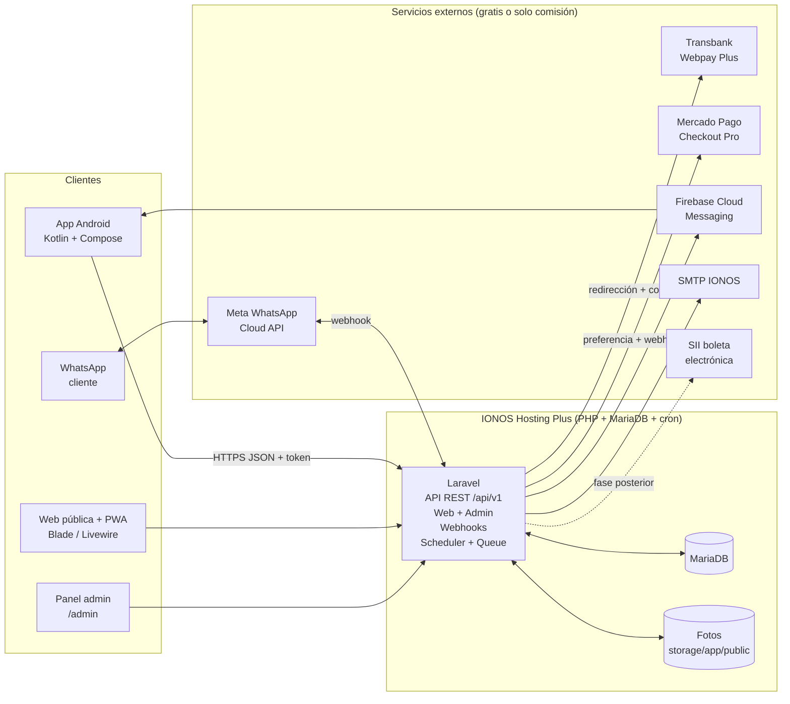

# 02 · Arquitectura técnica

Versión 1.0 · 21-10-2026

## 1. Visión general

Un único backend (Laravel) en el hosting compartido de IONOS sirve a tres clientes: la web pública con su panel de administración, la app Android y el bot de WhatsApp. Todos leen y escriben en la misma base MariaDB, así que app, web y WhatsApp están siempre sincronizados sin ningún mecanismo extra.



## 2. Stack

| Capa | Tecnología | Notas |
|---|---|---|
| Backend / web | PHP 8.2+ con **Laravel** (última versión estable al iniciar la fase 1) | Monolito modular: API, web, admin, webhooks, jobs. |
| Base de datos | **MariaDB** (IONOS, 2 GB por BD) | Esquema en `database/schema.sql`; en Laravel se expresa como migraciones. |
| Web pública / admin | Blade + **Livewire** + Alpine.js + Tailwind CSS | Interactividad sin un frontend aparte; mantenible por una sola persona. Manifest PWA para "instalar" en el móvil. |
| API | REST JSON `/api/v1`, autenticación con **Laravel Sanctum** (tokens para la app, sesión para la web) | Versionada desde el día 1. |
| App Android | **Kotlin**, Jetpack Compose, MVVM, Hilt, Retrofit + OkHttp, kotlinx.serialization, Room (caché), Coil (imágenes), WorkManager, Firebase Messaging, Chrome Custom Tabs para pagar | minSdk 26, targetSdk la vigente al publicar. |
| Colas y tareas | Driver `database` + **cron de IONOS** | Sin procesos permanentes en hosting compartido (ver §8). |
| Archivos | `storage/app/public` (fotos de perros y productos, redimensionadas con Intervention Image) | Espacio del plan de IONOS. |
| Email | SMTP de IONOS vía Laravel Mail (plantillas Markdown) | Alternativa gratuita: Brevo (300 correos/día). |
| Push | Firebase Cloud Messaging (FCM) | Gratis. |
| Errores | Logs de Laravel + Firebase Crashlytics en la app | Gratis. |
| CI | GitHub Actions (tests + lint) | Gratis dentro de la cuota de repos privados. |

## 3. Módulos del backend (carpetas `app/Domain/*`)

- **Accounts**: registro, login, verificación, recuperación, consentimientos, solicitudes de datos (ARCO).
- **Pets**: perros y sus fichas.
- **Visits**: historial de visitas y fotos.
- **Scheduling**: servicios, precios por tamaño, horarios, disponibilidad, citas.
- **Shop**: categorías, productos, stock, carritos, pedidos, despacho.
- **Payments**: abstracción `PaymentGateway` con dos implementaciones (`WebpayPlusGateway`, `MercadoPagoGateway`), registro de transacciones, webhooks.
- **Notifications**: reglas de recordatorio, plantillas, envío por email/push/WhatsApp, registro de envíos.
- **WhatsApp**: webhook de Meta, máquina de estados de la conversación, envío de mensajes interactivos.
- **Admin**: dashboard, CRUDs, exportaciones, configuración.
- **Billing** (fase posterior): boleta electrónica.

## 4. API REST (resumen `/api/v1`)

| Grupo | Endpoints principales |
|---|---|
| Auth | `POST /auth/register`, `POST /auth/login`, `POST /auth/logout`, `GET /auth/me`, `POST /auth/forgot`, `POST /auth/reset`, `POST /auth/verify-email` |
| Perfil | `GET/PUT /me`, `PUT /me/consents`, `POST /me/data-requests`, `DELETE /me` |
| Perros | `GET/POST /pets`, `GET/PUT/DELETE /pets/{id}`, `POST /pets/{id}/photo`, `GET /pets/{id}/visits` |
| Servicios | `GET /services` (con precios por tamaño), `GET /availability?date=&service_ids=&pet_id=` |
| Citas | `GET/POST /appointments`, `GET /appointments/{id}`, `POST /appointments/{id}/cancel`, `POST /appointments/{id}/reschedule` |
| Tienda | `GET /categories`, `GET /products`, `GET /products/{slug}` |
| Carrito | `GET /cart`, `POST /cart/items`, `PUT/DELETE /cart/items/{id}`, `POST /cart/merge` |
| Pedidos | `POST /orders` (desde el carrito), `GET /orders`, `GET /orders/{id}` |
| Pagos | `POST /payments/start` (devuelve URL de Webpay o Mercado Pago), `GET /payments/{id}` |
| Dispositivos | `POST /devices` (token FCM), `DELETE /devices/{token}` |
| Admin | `/admin/...` con los mismos recursos + agenda, visitas, recordatorios, configuración, exportaciones |

Webhooks y retornos (fuera de `/api/v1`, sin token de usuario, verificados por firma/secreto):

- `GET/POST /webhooks/whatsapp` (verificación y mensajes de Meta)
- `POST /webhooks/mercadopago` (notificaciones de pago)
- `GET|POST /pagos/webpay/retorno` (retorno de Webpay Plus; el servidor hace el `commit`)
- `GET /pagos/mercadopago/retorno` (vuelta del cliente; el estado real llega por webhook)

Todas las respuestas en JSON con estructura `{ data, meta, errors }`; fechas en ISO-8601 con zona `America/Santiago`; montos enteros en CLP.

## 5. Motor de disponibilidad y citas

1. Se toma el horario del día (`business_hours`), se restan bloqueos (`closures`) y citas existentes.
2. Duración = suma de duraciones de los servicios según el tamaño del perro.
3. Se generan huecos cada `slot_minutes` (por defecto 15) que quepan completos dentro de la capacidad.
4. Para evitar dobles reservas, la creación de la cita se hace en transacción con bloqueo (`SELECT ... FOR UPDATE` sobre las citas del día) y vuelve a validar el hueco.
5. La respuesta se cachea 60 s por día/servicio/tamaño (se invalida al crear o cancelar).

## 6. Pagos

Abstracción común: `start(Payable $payable): RedirectUrl`, `confirm(Request $r): PaymentResult`, `refund(Payment $p, int $amount)`.

**Webpay Plus (Transbank)** — SDK oficial `transbank/transbank-sdk` (Composer).
1. `POST /payments/start` crea el registro `payments` y llama a `Transaction::create(buyOrder, sessionId, amount, returnUrl)`.
2. Se redirige al cliente al `url` + `token_ws` de Transbank (en la app, en una Chrome Custom Tab).
3. Transbank vuelve a `returnUrl` con `token_ws`; el servidor ejecuta `commit(token)` y guarda `response_code`, `authorization_code`, `card_number` (4 últimos), `status`.
4. Si `response_code = 0` el pedido pasa a `pagado`; si no, `rechazado`. Luego se muestra el resultado y la app recibe push/deep link `lanositos://pago/{id}`.
5. Desarrollo con el **ambiente de integración** de Transbank (credenciales públicas de prueba); producción con el código de comercio y la API key que entrega Transbank tras el contrato.

**Mercado Pago (Checkout Pro)** — SDK oficial `mercadopago/dx-php`.
1. Se crea una `preference` con los ítems, `external_reference = payment.id`, `back_urls` y `notification_url`.
2. Se redirige al `init_point`.
3. El estado válido llega por **webhook** (`topic=payment`): se consulta el pago en la API y se concilia; la vuelta del cliente solo muestra información.
4. Sandbox con usuarios de prueba y tarjetas de prueba de Mercado Pago.

Reglas comunes: idempotencia por `buy_order`/`external_reference`, nunca confiar en parámetros de la URL de retorno, registrar la respuesta completa, reintento del webhook soportado (operación idempotente).

## 7. Boleta electrónica (fase posterior, cuando exista inicio de actividades)

Opciones gratuitas: emisión en el **sistema de facturación gratuito del SII** (manual o semiautomática desde el panel, que muestra los datos de cada venta a emitir). Opción automática: proveedores con API (tienen coste mensual, fuera de la política de coste cero salvo decisión expresa). El modelo guarda por venta: RUT (si lo dio el cliente), detalle con IVA desglosado, folio y fecha de la boleta cuando se emita.

## 8. Tareas programadas y colas en hosting compartido

IONOS Hosting Plus no permite procesos permanentes (`queue:work` como demonio), pero sí cron. Configuración:

```
* * * * *  cd /ruta/backend && php artisan schedule:run >> storage/logs/cron.log 2>&1
* * * * *  cd /ruta/backend && php artisan queue:work --stop-when-empty --max-time=50 >> storage/logs/queue.log 2>&1
```

Tareas del scheduler (hora de Chile):

| Tarea | Frecuencia | Qué hace |
|---|---|---|
| `reminders:visits` | Diaria 10:00 | Busca perros con última visita > intervalo del servicio, sin cita futura, dueño con consentimiento y sin recordatorio reciente → encola envíos (email, push; WhatsApp solo si está habilitado el envío de plantillas). |
| `reminders:appointments` | Cada hora | Citas en las próximas 24–25 h → recordatorio. |
| `admin:daily-digest` | Diaria 08:30 | Resumen para Paulina con la lista "le toca" y botones de WhatsApp. |
| `appointments:mark-no-show` | Cada hora | Citas pasadas sin completar → `no_asistio` (revisable). |
| `payments:reconcile` | Cada 30 min | Pagos `iniciado` de más de 30 min → consulta a la pasarela y cierra. |
| `backup:run` | Diaria 03:00 | Volcado de MariaDB + fotos a `storage/backups` (rotación 14 días); descarga semanal a `E:\Proyectos\Lanositos\_respaldos`. |
| `whatsapp:timeouts` | Cada 5 min | Cierra conversaciones del bot inactivas (30 min) y reactiva el bot tras el periodo "hablar con Paulina". |

## 9. WhatsApp Cloud API

- Cuenta: Meta Business + app en Meta for Developers + WhatsApp Business Account (WABA) + número de teléfono dedicado (no puede estar activo a la vez en la app WhatsApp normal). Token permanente mediante *System User*.
- Webhook: `GET /webhooks/whatsapp` (verificación con `hub.verify_token`), `POST` con firma `X-Hub-Signature-256` validada con el *app secret*.
- Mensajes salientes: texto, **botones** (hasta 3) y **listas** (hasta 10 opciones) para los menús; imágenes de productos; enlaces de pago.
- Conversación: máquina de estados guardada en `whatsapp_conversations.state` (JSON): `menu`, `agendar.perro`, `agendar.servicio`, `agendar.dia`, `agendar.hora`, `tienda.categoria`, `tienda.producto`, `carrito`, `humano`, etc. Cada estado tiene un manejador que interpreta la respuesta (id de botón/lista o texto) y responde.
- Costes (modelo de Meta vigente desde julio 2025 y actualizado en octubre 2026): las respuestas dentro de la ventana de 24 h abierta por el cliente son "mensajes de servicio": gratis hasta 1.000 al mes por número, luego con coste por mensaje; las **plantillas** iniciadas por el negocio (recordatorios de marketing o utilidad fuera de ventana) **siempre tienen coste**. Por eso el envío de plantillas está desactivado por defecto (`WHATSAPP_TEMPLATES_ENABLED=false`) y los recordatorios automáticos van por email y push, con el envío manual de un toque desde el panel (`https://wa.me/56XXXXXXXXX?text=...`).
- Plantillas que se dejarán aprobadas por si se activan: `recordatorio_cita` (utilidad), `le_toca_volver` (marketing), `pedido_pagado` (utilidad).

## 10. App Android (Kotlin)

- Arquitectura: `app` (UI Compose) + `core/network` (Retrofit, interceptor de token) + `core/data` (repositorios, Room) + `feature/*` (auth, pets, appointments, shop, cart, orders, profile).
- Navegación Compose con deep links: `lanositos://cita/{id}`, `lanositos://pago/{id}`, `lanositos://pedido/{id}`.
- Pago: se abre la URL devuelta por `POST /payments/start` en una Chrome Custom Tab; al terminar, el backend redirige a `lanositos://pago/{id}` y la app consulta el estado. (Google Play permite pagos externos para bienes físicos y servicios presenciales; no aplica Play Billing.)
- Sesión: token Sanctum guardado en `EncryptedSharedPreferences`.
- Caché: catálogo, servicios y historial en Room para consulta sin conexión; las escrituras siempre contra la API.
- Publicación: Android App Bundle firmado; ver requisitos de Google Play en doc 04 §6 y coste en doc 05.

## 11. Web pública y panel

- Rutas públicas: `/`, `/servicios`, `/tienda`, `/tienda/{slug}`, `/carrito`, `/checkout`, `/cuenta/*`, `/mis-perros/*`, `/citas/*`, `/legal/*`.
- Panel `/admin/*` protegido por rol, con Livewire para agenda, tablas y formularios.
- SEO básico (títulos, descripciones, datos estructurados `LocalBusiness` y `Product`), sitemap, imágenes WebP.
- PWA: manifest + service worker simple (caché de estáticos).

## 12. Seguridad y privacidad por diseño

- HTTPS con el certificado incluido en IONOS; HSTS.
- Contraseñas con bcrypt; tokens Sanctum con caducidad (30 días, renovación silenciosa).
- Limitación de intentos (login, registro, webhook), CSRF en web, validación estricta (Form Requests) también para lo que entra desde WhatsApp.
- Cifrado en reposo (`encrypted` cast de Laravel) para RUT y teléfono; fotos accesibles solo con URL firmada temporal.
- Registro de actividad del panel (quién, qué, cuándo) sin guardar datos sensibles en logs.
- Minimización: solo se piden los datos necesarios; el RUT es opcional y solo para boleta.
- Derechos de los titulares implementados como funciones (exportar, rectificar, eliminar/anonimizar, oponerse) con registro de cada solicitud.
- Copias de seguridad cifradas (zip con contraseña) y retención definida.

## 13. Entornos y despliegue

| Entorno | Dónde | Dominio |
|---|---|---|
| Local | PC de Jaime/Andrés (Laravel Herd o XAMPP + MariaDB; Android Studio) | `lanositos.test` |
| Pruebas | Subdominio en IONOS (`pruebas.<dominio>`) con BD propia | pasarelas en modo integración/sandbox |
| Producción | IONOS Hosting Plus, BD propia | `lanositos.cl` (dominio de Jaime en NIC Chile, DNS hacia IONOS) |

Despliegue en IONOS (hosting compartido):

1. Conectar por SSH, `git clone` del repo en una carpeta fuera del *document root* (por ejemplo `~/lanositos`).
2. Apuntar el dominio/subdominio a `~/lanositos/backend/public` desde el panel de IONOS (así `.env`, `storage` y el código no son accesibles desde la web).
3. `composer install --no-dev --optimize-autoloader`, `.env` de producción, `php artisan key:generate`, `migrate --force`, `storage:link`, `config:cache`, `route:cache`, `view:cache`.
4. Crear las dos tareas cron del §8 en el administrador de cron de IONOS.
5. Script `deploy.sh` que repite los pasos 3 para cada actualización; GitHub Actions ejecuta tests antes de cada merge a `main`.

Variables de entorno sensibles (`.env`, nunca en el repo): credenciales de BD, SMTP, Meta (token, app secret, verify token, phone number id), Transbank (commerce code, API key), Mercado Pago (access token), Firebase (archivo de servicio).

## 14. Rendimiento en hosting compartido

- Índices en todas las claves foráneas y en `appointments(scheduled_at)`, `visits(pet_id, visited_at)`, `products(slug)`.
- Caché de catálogo, servicios y disponibilidad (driver `file` o `database`).
- Imágenes redimensionadas al subir (máx. 1600 px) y servidas en WebP.
- Paginación en todas las listas; respuestas de API ligeras (sin cargar relaciones innecesarias).
- Opcache activado en el panel de IONOS.
