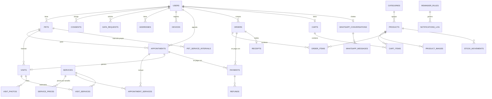

# 03 · Modelo de datos

Versión 1.0 · 21-10-2026 · Esquema completo en [`../database/schema.sql`](../database/schema.sql) (MariaDB, 36 tablas).

## 1. Diagrama de entidades principales

## 2. Entidades por módulo

### Cuentas y derechos
| Tabla | Para qué sirve | Notas |
|---|---|---|
| `users` | Clientes, administradora y personal (campo `role`). | Teléfono y RUT cifrados; `phone_hash` para buscar por número (WhatsApp). Borrado lógico + anonimización al suprimir. |
| `consents` | Historial de aceptaciones y retiradas (T&C, privacidad, marketing email/WhatsApp, retracto informado). | Nunca se borra: es la prueba del consentimiento. |
| `data_requests` | Solicitudes de acceso, rectificación, supresión, oposición, portabilidad y bloqueo. | `due_at` calcula el plazo de respuesta. |
| `addresses` | Direcciones de despacho. | |
| `devices` | Tokens FCM para push. | |

### Perros e historial
| Tabla | Para qué sirve | Notas |
|---|---|---|
| `pets` | Ficha del perro. | `size` decide el precio; `microchip`/`registry_number` opcionales. |
| `breeds` | Lista de razas (+ "mestizo"/otra). | |
| `pet_service_intervals` | Intervalo "le toca" personalizado por perro y servicio. | Si no hay fila, aplica `services.interval_days`. |
| `visits` | Cada visita realizada, con observaciones y próxima visita sugerida. | Con o sin cita previa. |
| `visit_services`, `visit_photos` | Servicios realizados y fotos antes/después. | Precio histórico copiado. |

### Agenda
| Tabla | Para qué sirve | Notas |
|---|---|---|
| `services`, `service_prices` | Catálogo de servicios con precio y duración por tamaño. | |
| `business_hours`, `closures` | Horario semanal y cierres puntuales. | |
| `appointments`, `appointment_services` | Citas con estado, origen (app/web/WhatsApp/admin), pago y notas. | Índice por `scheduled_at` para la agenda. |

### Tienda
| Tabla | Para qué sirve | Notas |
|---|---|---|
| `categories`, `products`, `product_images` | Catálogo. | Precio final con IVA incluido. |
| `shipping_zones` | Costo de despacho por comuna. | |
| `carts`, `cart_items` | Carrito (invitado, cliente o WhatsApp) compartido entre canales. | |
| `orders`, `order_items` | Pedido con copia histórica de precios, entrega y versión de T&C aceptada; `confirmation_sent_at` prueba la confirmación escrita. | `iva_clp` guardado para la boleta. |
| `stock_movements` | Trazabilidad del stock. | |

### Pagos
| Tabla | Para qué sirve | Notas |
|---|---|---|
| `payments` | Cada intento de pago (Webpay, Mercado Pago, local). | `buy_order` único = idempotencia. Respuesta cruda en JSON. |
| `refunds` | Anulaciones y reembolsos. | |
| `receipts` | Boletas electrónicas (folio, IVA, PDF). | Se usa cuando exista inicio de actividades. |

### Recordatorios y mensajería
| Tabla | Para qué sirve | Notas |
|---|---|---|
| `reminder_rules` | Qué se envía, a quién, por qué canal y con qué frecuencia mínima. | WhatsApp de pago desactivado por defecto. |
| `message_templates` | Textos editables por canal con variables. | |
| `notifications_log` | Registro de cada envío (estado, proveedor, error). | Evita repetir recordatorios. |
| `whatsapp_conversations`, `whatsapp_messages` | Estado del bot por número y registro de mensajes. | `last_inbound_at` marca la ventana gratuita de 24 h. |

### Configuración y auditoría
| Tabla | Para qué sirve |
|---|---|
| `settings` | Parámetros del negocio y del sistema (clave/valor por grupo). |
| `activity_log` | Quién cambió qué en el panel. |

## 3. Decisiones de diseño

- **Historial separado de las citas**: una visita puede existir sin cita (cliente que llega al local) y conserva lo realmente hecho y cobrado, aunque la cita original cambie.
- **Precios copiados** en `appointment_services`, `visit_services` y `order_items` para que el historial no cambie si se actualizan los precios.
- **Un único `payments` polimórfico** para pedidos y citas, con una interfaz común de pasarela.
- **Consentimientos como historial**, no como un simple booleano: la Ley 21.719 exige poder demostrar cuándo y cómo se otorgó o retiró.
- **Datos personales cifrados en reposo** donde más duelen (teléfono, RUT) y `phone_hash` para poder buscar.
- **JSON** solo para respuestas de pasarelas, contexto del bot y auditoría; todo lo consultable va en columnas normales con índices.
- **Preparado para crecer** sin rehacer: `staff_id` en citas y visitas, `capacity` en configuración, `parent_id` en categorías, `receipts` para boletas.

## 4. Pasos siguientes

1. Confirmar con Paulina servicios, tamaños, intervalos y horario (datos de ejemplo al final de `schema.sql`).
2. Fase 1: convertir el esquema en migraciones y modelos Eloquent, con *factories* y *seeders* para pruebas.
